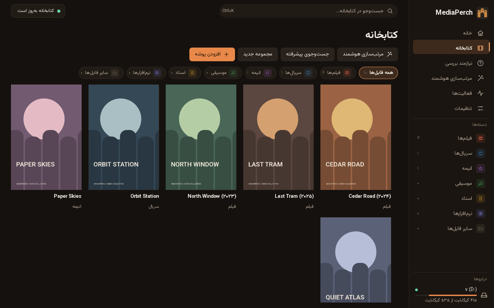
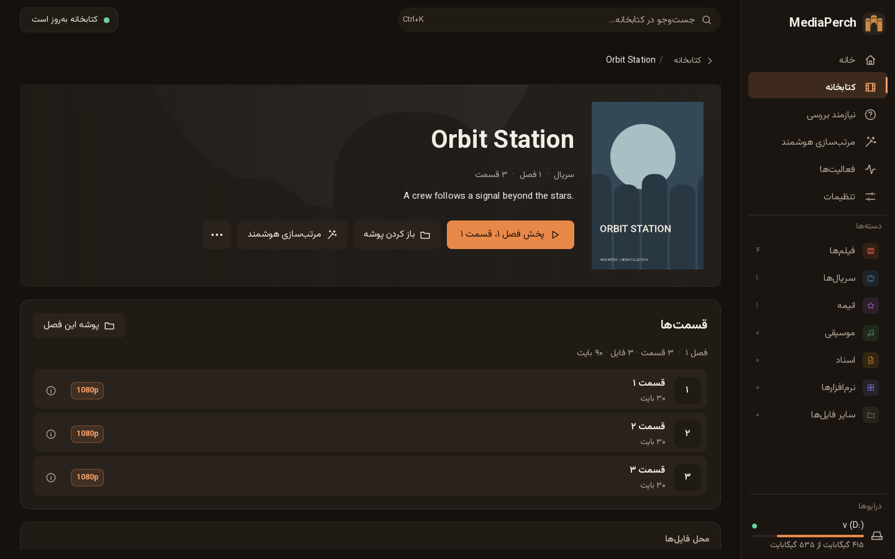
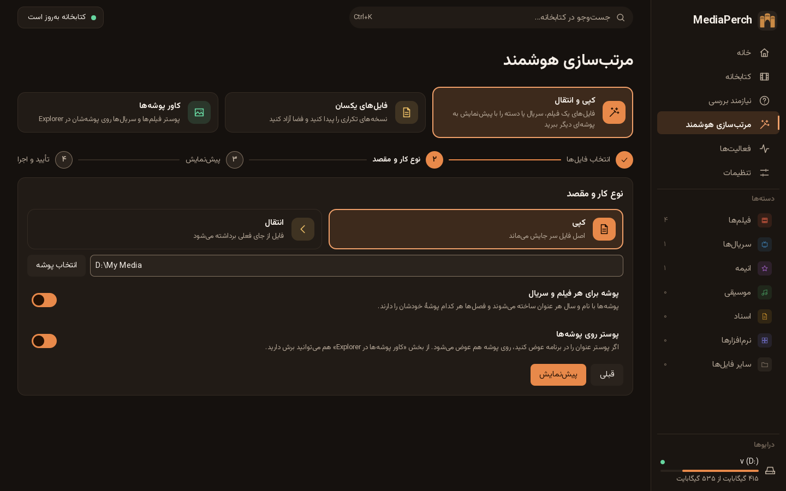

# MediaPerch

**خانه‌ای برای آرشیو شخصی شما — روی ویندوز و لینوکس، با رابط فارسی و انگلیسی.**

[دانلود نسخهٔ ویندوز](https://github.com/sajjadka21/MediaPerch/releases/latest) · [English](README.md) · [گزارش مشکل](https://github.com/sajjadka21/MediaPerch/issues)

MediaPerch پوشه‌های فیلم، سریال، انیمه و فایل‌های دیگر را به کتابخانه‌ای قابل جست‌وجو تبدیل می‌کند. عنوان‌ها را با پوستر ببینید، فصل و قسمت را پیدا کنید و وقتی خواستید، فایل‌ها را با پیش‌نمایش مرتب کنید.

*این تصاویر از خود برنامه، با عنوان‌های ساختگی و پوسترهای نمایشی اختصاصی گرفته شده‌اند؛ اطلاعات کتابخانهٔ شخصی کسی منتشر نشده است.*

## نصب

اولین نسخهٔ عمومی **0.9.0** است. شماره‌های قبلی متعلق به تست‌های داخلی بودند.

### لینوکس

چهار قالب برای **x86_64** ارائه شده است:

- [AppImage قابل‌حمل](https://github.com/sajjadka21/MediaPerch/releases/download/v0.9.0/MediaPerch-0.9.0-linux-x86_64.AppImage): اجازهٔ اجرا بدهید و بازش کنید.
- [بستهٔ deb](https://github.com/sajjadka21/MediaPerch/releases/download/v0.9.0/MediaPerch-0.9.0-linux-x86_64.deb): برای اوبونتو، دبیان و مینت.
- [بستهٔ rpm](https://github.com/sajjadka21/MediaPerch/releases/download/v0.9.0/MediaPerch-0.9.0-linux-x86_64.rpm): برای سیستم‌های سازگار با فدورا.
- [بستهٔ tar.gz](https://github.com/sajjadka21/MediaPerch/releases/download/v0.9.0/MediaPerch-0.9.0-linux-x86_64.tar.gz): استخراج کنید و فایل `MediaPerch` را اجرا کنید.

این خروجی‌ها **glibc 2.39 یا جدیدتر** می‌خواهند؛ مانند Ubuntu 24.04، Mint 22، Debian 13 یا Fedora 40 و جدیدتر. برای ARM یا توزیع‌های قدیمی‌تر نیستند. [راهنمای کامل نصب لینوکس](docs/LINUX.md) شامل فرمان‌های نصب، بررسی checksum و تفاوت‌های نسخه‌هاست.

پایتون همراه بسته است. کتابخانهٔ لینوکس معمولاً در `~/.local/share/mediaperch` ذخیره می‌شود. قابلیت آیکن پوشهٔ Explorer فقط برای ویندوز است و در لینوکس نمایش داده نمی‌شود؛ به‌روزرسانی لینوکس از طریق بستهٔ جدید یا مدیر بسته انجام می‌شود.

### ویندوز

1. فایل [MediaPerch-0.9.0-setup.exe](https://github.com/sajjadka21/MediaPerch/releases/download/v0.9.0/MediaPerch-0.9.0-setup.exe) را دانلود و اجرا کنید. نیازی به نصب پایتون ندارید.
2. گزینهٔ ساخت میان‌بر دسکتاپ با آیکن جدید در نصب‌کننده وجود دارد.
3. پوشه‌های آرشیوتان را انتخاب کنید و اجازه دهید اسکن اول تمام شود.
4. زبان و ظاهر دلخواه را از تنظیمات انتخاب کنید.

ویندوز **۱۰ نسخهٔ 1809 یا جدیدتر، یا ویندوز ۱۱، با معماری ۶۴ بیت** لازم است. برای دریافت پوستر و اطلاعات تازه اینترنت لازم است؛ فهرست محلی بدون اینترنت هم قابل استفاده است.

اگر نسخهٔ آزمایشی را قبلاً نصب کرده‌اید و می‌خواهید از نو نصب کنید، ابتدا آن را کامل ببندید و حذف کنید. هنگام حذف، نگه‌داشتن کتابخانه انتخاب پیش‌فرض است؛ آن را نگه دارید مگر اینکه عمداً بخواهید اسکن و تنظیمات را از ابتدا انجام دهید. فایل‌های اصلی آرشیوتان جدا هستند.

## امکانات

- شناسایی فیلم، سریال، انیمه، فصل، قسمت، سال و کیفیت از نام فایل.
- کتابخانهٔ تصویری، گروه‌بندی فصل‌ها و بازکردن قسمت در پخش‌کنندهٔ خودتان.
- انتخاب از نتایج آنلاین با **پوستر، نام، سال و خلاصه** برای عنوان‌های هم‌نام.
- جست‌وجوی فارسی و انگلیسی، فیلترهای پیشرفته، برچسب و مجموعه. میان‌بر جست‌وجوی سریع: **Ctrl+K**.
- مرتب‌سازی از داخل صفحهٔ هر عنوان، کتابخانهٔ مربوط، مجموعه یا منوی کناری.
- ساخت پوشه با نام هر عنوان و پوشهٔ فصل‌ها، همراه با زیرنویس‌های متصل.
- گذاشتن پوستر روی پوشهٔ Explorer، تغییر آن با عوض‌کردن پوستر عنوان، و امکان برداشتن آیکن پوشه.
- حفظ اطلاعات فایل‌های درایو جداشده تا اتصال دوباره.
- تم‌های گرم و تیره، رابط راست‌به‌چپ فارسی و چپ‌به‌راست انگلیسی.

## مرتب‌سازی از همان کتابخانه

داخل صفحهٔ فیلم، سریال یا انیمه، دکمهٔ **مرتب‌سازی هوشمند** کنار پخش قرار دارد. داخل کتابخانه هم همین گزینه فقط فایل‌های دسته یا مجموعهٔ فعلی را انتخاب می‌کند.

مسیر مقصد را مشخص کنید؛ برنامه پوشهٔ هر عنوان و در صورت نیاز فصل‌هایش را می‌سازد. حالت پیش‌فرض **کپی** است و اصل فایل سر جایش می‌ماند. انتقال را باید خودتان انتخاب کنید. پیش از هر اجرا، مسیرهای دقیق و برخورد نام‌ها در پیش‌نمایش نشان داده می‌شوند.

فایل موجود خودکار بازنویسی نمی‌شود. عملیات در فعالیت‌ها ثبت می‌شود و بازگرداندن، وقتی فایل‌ها نسبت به سابقه تغییر نکرده باشند، ممکن است. بعد از بازگرداندن عملیات ممکن است پوشه‌های خالی باقی بمانند.

## پوستر و اطلاعات

برای انیمه، ابتدا **AnimeGate** برای پوستر و خلاصهٔ فارسی بررسی می‌شود. فیلم و سریال ابتدا از **TMDB** جست‌وجو می‌شوند. منابع دیگر شامل TVmaze، AniList و Kitsu هستند. نام منبع کنار اطلاعات عنوان نمایش داده می‌شود.

اگر چند نتیجهٔ هم‌نام وجود داشته باشد، از گزینهٔ **انتخاب از نتایج آنلاین** استفاده کنید و پوسترها را مقایسه کنید. امکان انتخاب کاور از رایانهٔ خودتان هم وجود دارد. در حالت استفاده از سرویس مشترک نیازی به کلید شخصی ندارید؛ پروکسی و تنظیمات شخصی نیز اختیاری‌اند.

MediaPerch سرویس دانلود فیلم یا اشتراک پخش نیست؛ فایل موجود شما را در پخش‌کنندهٔ نصب‌شده باز می‌کند.

## حریم خصوصی و نگه‌داری اطلاعات

کتابخانه، برچسب‌ها، مجموعه‌ها و سابقهٔ عملیات روی رایانهٔ خودتان ذخیره می‌شوند. برای جست‌وجوی آنلاین نام عنوان ارسال می‌شود، نه محتوای ویدیوها و اسناد. اشتراک قالب نام فایل، انتخاب جداگانه دارد.

جست‌وجوی اختیاری در متن فایل‌ها به‌صورت پیش‌فرض خاموش است و محلی می‌ماند. برنامه درایو قطع‌شده را با فایل حذف‌شده اشتباه نمی‌گیرد.

برای حفظ اطلاعات تست‌های قبلی، مسیر داده همچنان `%LOCALAPPDATA%\MediaHub` است. نصب تازهٔ خود برنامه در `%LOCALAPPDATA%\Programs\MediaPerch` انجام می‌شود. حذف برنامه به‌طور پیش‌فرض کتابخانه را نگه می‌دارد.

## اگر مشکلی داشتید

اگر پوستر نیامد، اتصال اینترنت را بررسی کنید و از انتخاب دستی نتیجه یا کاور استفاده کنید. دسترسی به بعضی منابع به منطقه و شبکه بستگی دارد.

برای گزارش خطا، در [بخش Issues](https://github.com/sajjadka21/MediaPerch/issues) نسخهٔ برنامه، نسخهٔ ویندوز و مراحل رخ‌دادن مشکل را بنویسید. مسیرها و اطلاعات شخصی را از تصویر گزارش حذف کنید.

این مخزن محل انتشار نصب‌کننده، مستندات محصول و تصاویر است. این نسخه پیش‌نمایش عمومی است و بررسی روی ویندوزهای تازه‌نصب‌شده و سخت‌افزارهای مختلف ادامه دارد. مجوزها و اطلاعیه‌های اجزای ثالث همراه نصب‌کننده قرار دارند.
