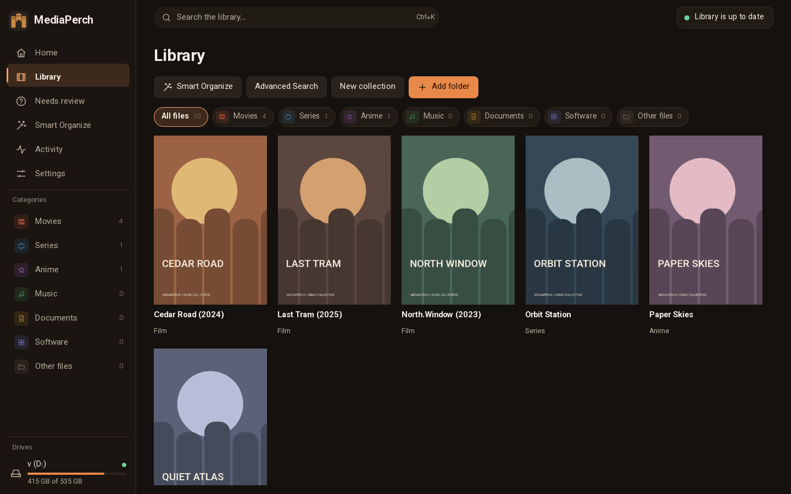
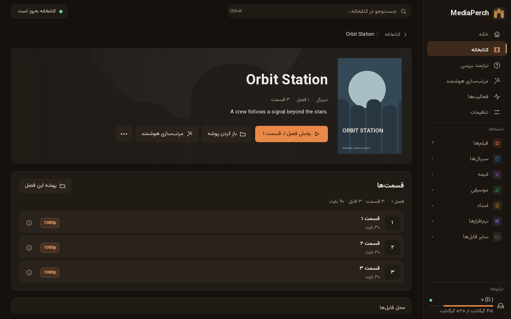
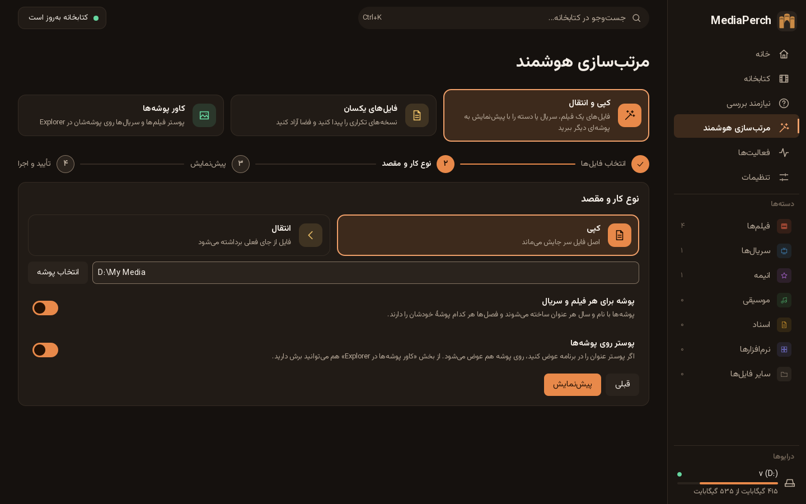

  

<h1 align="center">MediaPerch</h1>

A home for the media you already own.

Windows & Linux x86_64 · English & فارسی · Local-first

  <a href="https://github.com/sajjadka21/MediaPerch/releases/latest">Download</a>
  · <a href="docs/LINUX.md">Linux guide</a>
  · <a href="README.fa.md">راهنمای فارسی</a>
  · <a href="https://github.com/sajjadka21/MediaPerch/issues">Report an issue</a>

MediaPerch turns folders of films, TV episodes, anime and other files into a searchable personal library. Browse poster cards, find an episode, open it in your usual player, and organize files into clearly named folders when you choose.

*Screenshots show the actual application with fictional demo titles and original illustrative artwork. No personal library or third-party posters were published.*

## Download and install

**Current public release: 0.9.0.** Earlier MediaHub/MediaPerch builds were internal test versions; public releases start here.

| Platform / package | Download |
| --- | --- |
| Windows x64 installer | [setup.exe](https://github.com/sajjadka21/MediaPerch/releases/download/v0.9.0/MediaPerch-0.9.0-setup.exe) |
| Linux portable single file | [AppImage](https://github.com/sajjadka21/MediaPerch/releases/download/v0.9.0/MediaPerch-0.9.0-linux-x86_64.AppImage) |
| Ubuntu / Debian / Linux Mint | [deb](https://github.com/sajjadka21/MediaPerch/releases/download/v0.9.0/MediaPerch-0.9.0-linux-x86_64.deb) |
| Fedora-compatible systems | [rpm](https://github.com/sajjadka21/MediaPerch/releases/download/v0.9.0/MediaPerch-0.9.0-linux-x86_64.rpm) |
| Linux portable directory | [tar.gz](https://github.com/sajjadka21/MediaPerch/releases/download/v0.9.0/MediaPerch-0.9.0-linux-x86_64.tar.gz) |

Linux packages require **x86_64 and glibc 2.39+** (Ubuntu 24.04+, Mint 22+, Debian 13+, Fedora 40+ or similarly recent systems). See the [Linux installation guide](docs/LINUX.md) for commands and platform differences. ARM and older glibc systems are not supported by these binaries.

### Windows installation

1. Download [MediaPerch-0.9.0-setup.exe](https://github.com/sajjadka21/MediaPerch/releases/download/v0.9.0/MediaPerch-0.9.0-setup.exe).
2. Run the installer. Python is not required. The installer offers a desktop shortcut with the MediaPerch icon.
3. Open MediaPerch, pick the folders you want to catalogue, and let the first scan finish.
4. Choose **English** or **فارسی** in Settings. Both left-to-right and right-to-left layouts are supported.

Requires **64-bit Windows 10 version 1809 or later, or Windows 11**. Internet is used for online title information, poster downloads and updates; the local catalogue remains usable offline. macOS builds are not available.

## What you can do

| Feature | How it helps |
| --- | --- |
| Poster library | Browse films, shows and anime by their cover art, seasons and episodes. |
| Smart identification | Read title, year, quality and episode information from filenames. Review uncertain matches yourself. |
| Visual match picker | When several titles share a name, compare posters, years and summaries before selecting the right record. |
| Fast local search | Find files with Persian/English search, advanced filters, tags and collections. Press **Ctrl+K** for quick search. |
| Smart Organize | Open it from a title, its library category, a collection or the sidebar. The relevant files are already selected. |
| Folder artwork (Windows) | Put a title's poster on its Explorer folder, change the poster later, or remove the folder icon. |
| Drive awareness | Keep track of media on disconnected drives and find it again when the drive returns. |
| Appearance and language | Choose warm or dark themes and switch between Persian and English. |
| Update checks | Download installers with resume support and verify update signatures and file hashes before installation. |

## From a title to an organized folder

Open a film, show or anime and choose **Smart Organize** beside the playback controls. The same action is available inside its library, where it includes only the current category or collection.

Pick a destination. MediaPerch proposes a folder such as `Cedar Road (2024)`, groups a multi-season show into season folders, and takes linked subtitles along. The default operation is **Copy**, so the source stays in place.

Review the exact source and destination paths before approving. Existing files are never overwritten automatically. Move is an explicit choice; cross-drive moves verify the copy before removing the source. Activity records the operation, and Undo is available where the recorded files are still unchanged. Empty folders can remain after Undo.

## Posters and online information

For anime, MediaPerch tries **AnimeGate** first for posters and Persian summaries. Films and TV shows try **TMDB** first, with additional supported sources including TVmaze, AniList and Kitsu. Availability depends on the source and your connection.

If a name is ambiguous, use **Pick from online results** on the title page. You can also choose your own cover image. MediaPerch displays the information source with the title.

Online lookups use MediaPerch's relay where needed; you do not need to enter a provider key for the shared service. Settings also offer an optional proxy or your own provider configuration. Playback opens your installed player; MediaPerch does not provide films, streaming subscriptions or media downloads.

## Local data and file safety

- Your catalogue, collections, tags and operation history are stored locally in SQLite.
- Scanning indexes files; copying and moving require a separate preview and approval.
- Online lookups send title queries, not the contents of your videos or documents. Optional filename-format sharing requires its own choice.
- Optional text indexing is off by default and stays on your computer. Turning it off clears its index.
- External drives are treated as offline when disconnected, not as deleted files.
- Uninstalling keeps your catalogue by default. If you choose to delete the catalogue, your original media files are still separate.

On Windows the app retains `%LOCALAPPDATA%\MediaHub` as its catalogue directory for continuity with internal tests. Fresh program installs use `%LOCALAPPDATA%\Programs\MediaPerch`. Linux uses `$XDG_DATA_HOME/mediaperch` (normally `~/.local/share/mediaperch`); Linux updates are installed through the package manager or by replacing the portable package.

## Questions and troubleshooting

**No poster appeared.** Give online lookup time to finish, check your connection, then use the visual result picker or choose a cover yourself. Some providers may be unavailable in your region.

**A drive's media is unavailable.** Reconnect the drive. Its catalogue entries remain visible while it is offline.

**Can I work offline?** Yes: browse/search the existing catalogue and organize accessible local files. Fetching new posters or updates requires a connection.

**Where is the media player?** MediaPerch opens a playable file using your Windows-associated media player.

**How do I report a problem?** [Open an issue](https://github.com/sajjadka21/MediaPerch/issues) with the app version, Windows version, what you expected and what happened. Remove personal paths or account details from screenshots before posting.

## Project and credits

This repository hosts public Windows and Linux packages, product documentation and screenshots. This is the first public preview; clean Windows VM testing and physical drive-ejection coverage remain ongoing. Linux startup and native library/file operations are tested on Ubuntu 24.04 under WSL; independent Fedora hardware testing remains open.

Built with **Python**, **Qt for Python / PySide6**, **QML** and **SQLite**, using the bundled **Vazirmatn** font. Third-party notices and licences are included with the installer.

Metadata/artwork sources include [TMDB](https://www.themoviedb.org/), [AnimeGate](https://animegate.net/), [TVmaze](https://www.tvmaze.com/), [AniList](https://anilist.co/) and [Kitsu](https://kitsu.io/). MediaPerch is an independent application.
